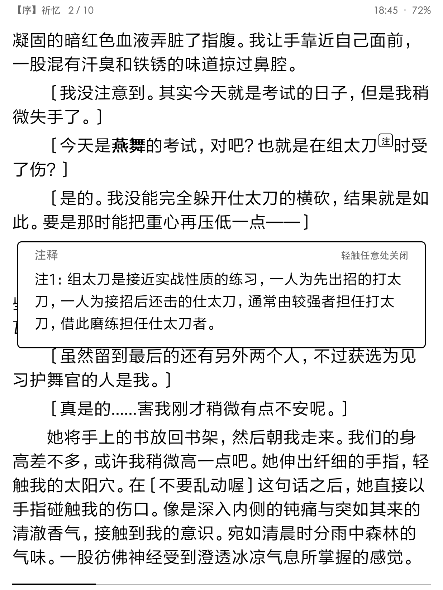

<div align="center">

# KinNovel

在已越狱的 Kindle 上阅读轻书架的小说与漫画

[](https://github.com/mmnnwjw/KinNovel/releases/latest)
[](https://github.com/mmnnwjw/KinNovel/actions/workflows/ci.yml)
[](LICENSE)





</div>

## 关于

KinNovel 是 [轻书架](https://www.lightnovel.life) 的非官方 Kindle 客户端。它直接运行在 Kindle 的原生系统里，通过 KUAL 启动。

## 功能

- **小说**：按网页版的样式排版，粗体、居中、引用、分隔线、注音都和网页上一样；点正文里的「注」图标弹出注释。字号、行距、段间距、页边距可调，简繁转换，插图点开可全屏放大。
- **书签与跳页**：菜单里一键加书签，在「目录与书签」里查看；拖动进度条可在章内快速跳页。
- **漫画**：支持跨页和从右到左翻页，后台预取后面几页。
- **横屏阅读**：小说和漫画都可以横过来读，在阅读菜单里一键切换，离开阅读页自动回到竖屏。
- **书架**：显示云端书架和文件夹。可以新建、重命名、删除文件夹，把书移到别的文件夹，或移出书架；在详情页可以加入书架。
- **找书**：浏览最新、排行和分类，也可以用屏幕键盘拼音输入来搜索。
- **离线阅读**：章节、字体和图片都会缓存，网络断开或站点暂时不可用时照样能读。
- **阅读统计**：记录每天的阅读时长和页数、连续阅读天数，以及读得最多的书。统计只保存在本机。
- **更多**：阅读时可调前光和色温；夜间模式在 PW5 及更新机型上由屏幕驱动反色、用夜间专用的刷新方式；可选休眠时显示当前书的封面，「存储空间」页可清理缓存；有新版本时会提示，并可在应用内直接下载安装。

## 安装

### 需要

- 已越狱、装有 [KUAL](https://www.mobileread.com/forums/showthread.php?t=203326) 的 Kindle，固件 5.x。程序是静态链接的，新旧固件（5.16.3 起的硬浮点、之前的软浮点）都能用，不需要装 Python 等运行环境。
- 机型：Paperwhite 2 及之后的触屏 Kindle。Kindle Touch 和 Paperwhite 1 的系统内核太老，可能无法运行。
- 目前只在 Kindle Paperwhite 5 上实机测试过。其他机型按 KOReader 的机型表做了适配，欢迎反馈使用情况。

### 步骤

1. 从 [Releases](https://github.com/mmnnwjw/KinNovel/releases/latest) 下载 `KinNovel-vX.Y.Z.zip` 并解压。
2. 用 USB 连接 Kindle，把 `KinNovel` 文件夹里的全部内容复制到 `extensions/kinnovel/`。
3. 在 KUAL 中选择 **KinNovel**。第一次打开是欢迎页，用屏幕键盘输入轻书架的邮箱和密码登录，就能同步云端书架和阅读进度；也可以点「先逛逛」，以后在「我的」里登录。

登录过期后，KinNovel 会用保存的账号自动重新登录；如果服务器说账号或密码不对（比如在网站上改了密码），就删掉保存的账号并回到登录页。本机只保存密码的哈希值，不保存明文。

KUAL 里还有一个 **KinNovel 工具箱** 菜单：

- **检查更新**：显示新版本的更新说明（跨了几个版本就列出每个版本的改动），可以直接下载安装，装好后点「立即重启」。也可以在「我的 → 关于」里检查和更新；开着「自动检查更新」时，启动后发现新版本会在书架上弹一次提示（每个版本只弹一次）。连不上 GitHub 时会依次改用 Gitee 镜像和 GitHub 加速镜像，下载的安装包都会校验 SHA-256。
- **卸载 KinNovel**：确认后删除整个 `extensions/kinnovel/` 文件夹（程序、设置、账号、缓存、本机的进度和书签），服务器上的书架和进度不受影响。手动删除这个文件夹效果相同。

手动升级时直接覆盖安装即可，设置、账号、进度、书签和缓存都会保留。从 1.4 及更早的版本升级时，`bin/config.json` 里的设置和账号会自动迁移到 `data/`，旧文件随后删除。

## 使用

| 操作 | 效果 |
|:--|:--|
| 点屏幕右侧 / 左滑 | 下一页 |
| 点屏幕左侧 / 右滑 | 上一页 |
| 点屏幕中间 / 下滑 | 打开阅读菜单（目录与书签、字号、横屏 / 竖屏、亮度、设置） |
| 菜单顶栏的书签图标 | 给当前页加书签，或删除这一页的书签 |
| 拖动菜单里的进度条 | 跳到本章任意一页 |
| 点插图 | 全屏查看并放大 |
| 点正文里的「注」图标 | 弹出注释，点任意处关闭 |
| 在「目录与书签」里长按书签 | 删除书签 |
| 书架上的「＋ 新建文件夹」 | 在当前这一层新建文件夹 |
| 长按书架上的书 / 文件夹 | 移动到别的文件夹、移出书架 / 重命名、删除文件夹 |
| 列表页上滑 / 下滑 | 下一页 / 上一页 |
| 「我的 → 退出」 | 退出并回到 Kindle 原来的界面 |

搜索时用屏幕键盘输入：

| 操作 | 效果 |
|:--|:--|
| 「中 / 英」键 | 切换中文（拼音）和英文 |
| 打拼音后点候选词 | 输入这个词；按空格、回车或标点输入第一个候选 |
| 候选词较多时按 ← → | 翻看更多候选 |
| 「符号」键 | 切换到标点符号，Shift 换一页 |
| 在 ， 。 键上向上滑 | 输入 ； ： |
| 长按退格 / 长按 Shift | 清空输入 / 锁定大写 |

第一次进入书架、阅读页、漫画、搜索键盘、目录与书签和插图查看时，会弹出这一页的操作提示：点「我知道了」以后不再出现，点「感觉会忘记」则下次启动后还会提示。可以在「设置 → 显示 → 操作提示」里关闭；重新打开后所有提示会再显示一次。

其他选项都在「我的 → 设置」里，也可以直接编辑 `data/settings.json`。「休眠显示封面」重启 KinNovel 后生效。

### 遇到问题

- 程序日志在 `extensions/kinnovel/logs/kinnovel.log`。异常退出时，下次启动会提示一次，详细信息也写在这个日志里。
- 问题和建议请提交到 [Issues](https://github.com/mmnnwjw/KinNovel/issues)，并附上日志。

## 参与开发

项目用 Rust 编写。设计说明见 [`rust/DESIGN.md`](rust/DESIGN.md)，各页面的界面规范见 [`rust/UI-DESIGN.md`](rust/UI-DESIGN.md)，各机型的差异见 [`rust/research-kindle-devices.md`](rust/research-kindle-devices.md)。

```bash
git clone --recursive https://github.com/mmnnwjw/KinNovel.git
cd KinNovel/rust
./build.sh host-test    # 运行测试
./build.sh kindle       # 构建 Kindle 程序 (armv7, 静态链接)
./build.sh host         # 主机预览程序: kinnovel --preview out.pgm
```

构建需要 Rust、[cargo-zigbuild](https://github.com/rust-cross/cargo-zigbuild)，以及 pip 安装的 `ziglang`。推送 `vX.Y.Z` 标签后，GitHub Actions 会自动构建并发布 Release。

早先的 Python 版本保存在 [`legacy`](https://github.com/mmnnwjw/KinNovel/tree/legacy) 分支。

欢迎提交 Pull Request。

## 维护者与致谢

由 [@mmnnwjw](https://github.com/mmnnwjw) 维护，代码由 Claude Opus 5.5 与 Claude Sonnet 5.5 编写。

- 接口与阅读模型参考 [LightNovelShelf/Web](https://github.com/LightNovelShelf/Web)。
- 屏幕驱动来自 [FBInk](https://github.com/NiLuJe/FBInk)。
- 机型适配、刷新策略、屏幕键盘和休眠封面参考 [KOReader](https://github.com/koreader/koreader) 与 [kComics](https://github.com/lxdklp/kComics)。
- 拼音词库来自 [rime-pinyin-simp](https://github.com/rime/rime-pinyin-simp)。

第三方组件及其许可见 [`THIRD-PARTY-NOTICES.md`](THIRD-PARTY-NOTICES.md)。

## 许可

以 [GPLv3](LICENSE) 发布。轻书架上的内容、封面与字体归原站及权利人所有。
